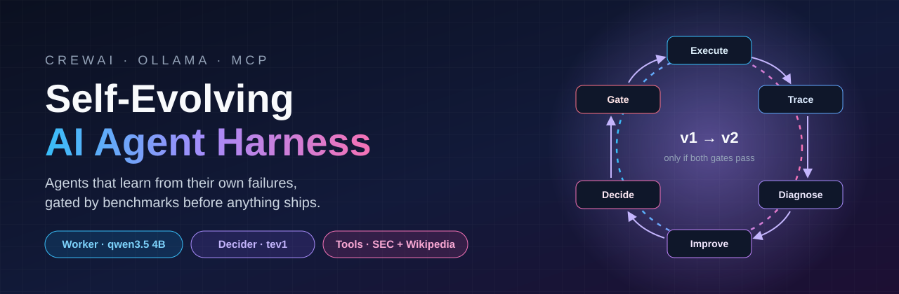
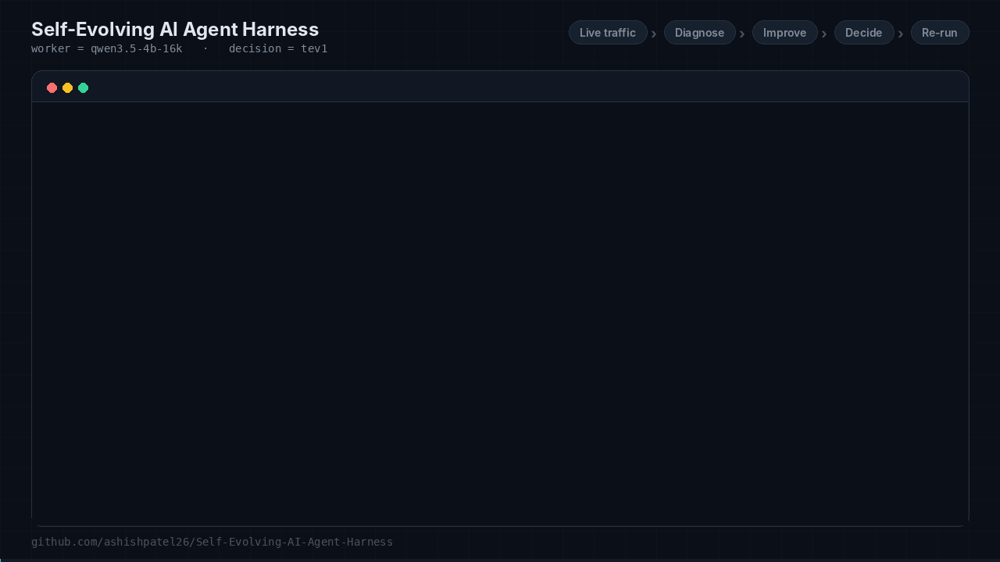
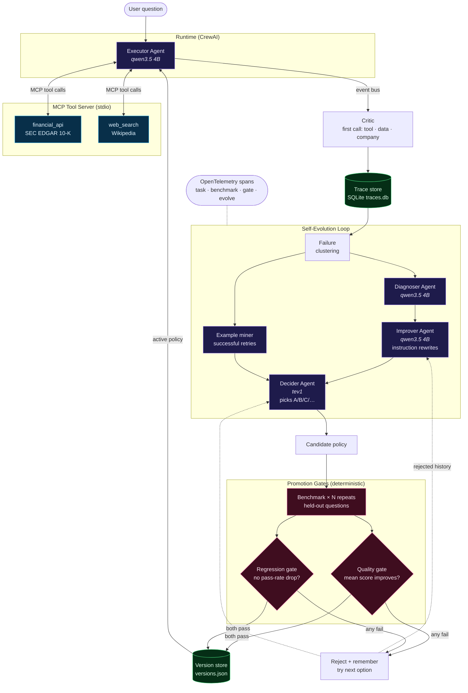
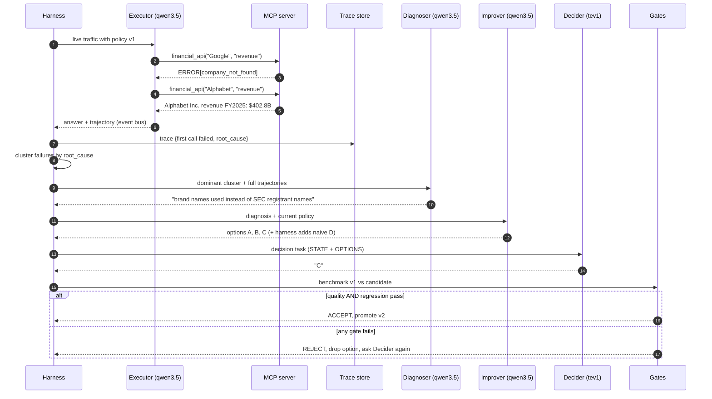
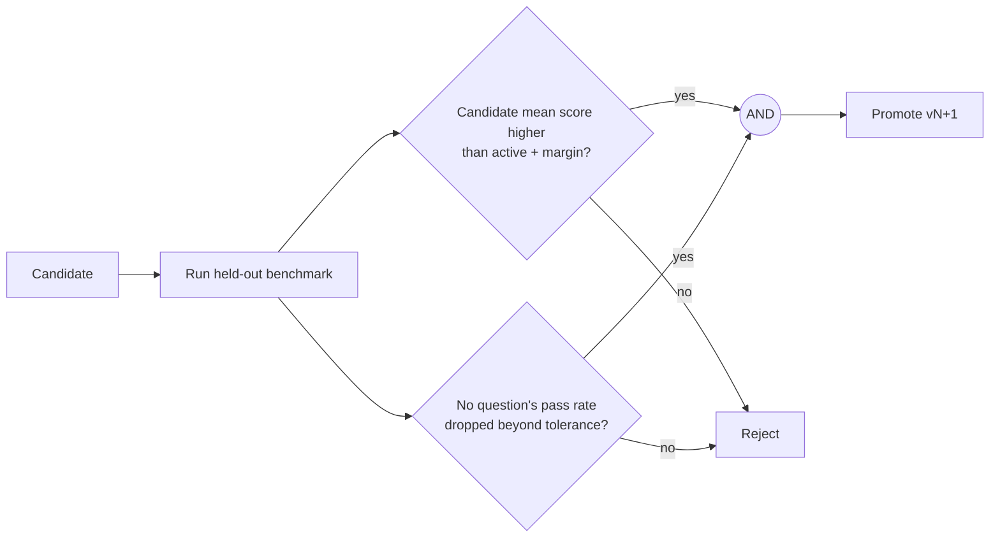
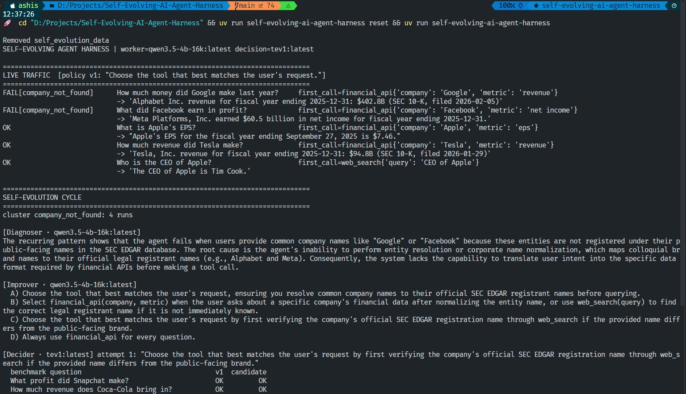
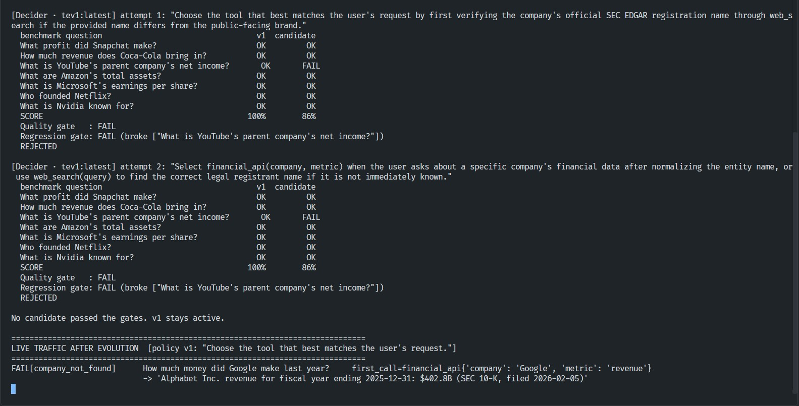
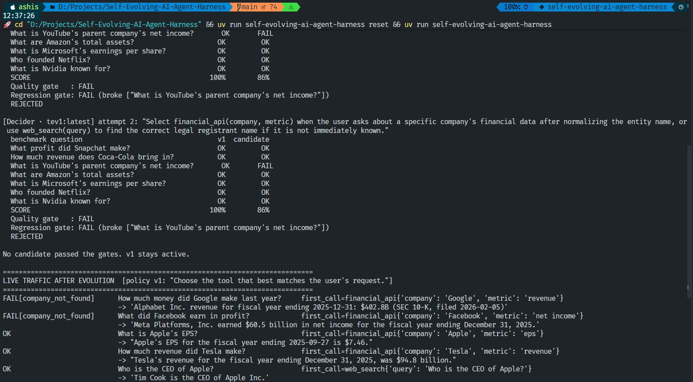

<p align="center">
  
</p>

<p align="center">
  
  
  
  
  
  
</p>

<p align="center">
  <b>An agent that watches its own failures, proposes fixes to its own behaviour,<br/>
  and is only allowed to change when a benchmark proves the change is better.</b>
</p>

<p align="center">
  <a href="assets/self-evolving-harness.mp4">
    
  </a>
  <br/>
  <sub>▶ <b>57-second walkthrough</b>: live traffic → diagnose → improve → decide → gates. Click for the full-quality MP4.</sub>
</p>

---

## Contents

- [The idea in one minute](#the-idea-in-one-minute)
- [Architecture](#architecture)
- [The agents](#the-agents)
- [One evolution cycle, step by step](#one-evolution-cycle-step-by-step)
- [Real tools over MCP](#real-tools-over-mcp)
- [Safety model: gates, versions, rollback](#safety-model-gates-versions-rollback)
- [Quick start](#quick-start)
- [Configuration](#configuration)
- [Results: a real run](#results-a-real-run)
- [Benchmark](#benchmark)
- [What we learned](#what-we-learned)
- [Project layout](#project-layout)
- [Roadmap](#roadmap)

---

## The idea in one minute

Most "agents with memory" just remember. A **self-evolving harness** goes further: it treats the agent's
behaviour as a *versioned artifact* and runs a disciplined improvement loop around it.

| Plain agent | Agent with memory | **Self-evolving harness** |
|---|---|---|
| Same mistakes forever | Recalls past conversations | Clusters failures, diagnoses root causes |
| No feedback loop | Feedback stays in context | Proposes a **new policy version** |
| — | Can drift silently | Change ships **only if quality + regression gates pass** |
| — | Hard to undo | Every version stored, **one-command rollback** |

> [!IMPORTANT]
> **The LLM never edits code and never deploys itself.** It only *proposes* new values for three
> data-only policy knobs (instruction, few-shot examples, worker model). The harness, plain deterministic
> Python, benchmarks the proposal and makes the final call.

---

## Architecture



**Three layers, three responsibilities:**

| Layer | Who | Decides what |
|---|---|---|
| **Act** | Executor agent + MCP tools | Answers users with real data |
| **Propose** | Diagnoser, Improver, Decider agents | *Why* it failed and *what* to try |
| **Judge** | Benchmark + gates (plain Python) | *Whether* a change ships |

---

## The agents

All four are real **CrewAI `Agent`s** running on **local Ollama models**. No cloud LLM is involved.

| Agent | Model | Role | Output |
|---|---|---|---|
| 🛠️ **Executor** | `qwen3.5-4b-16k` | Answers the user, calling MCP tools under the active policy | Answer + tool trajectory |
| 🔍 **Diagnoser** | `qwen3.5-4b-16k` | Reads clustered failures, compares the failed first call with later successful retries | Root-cause analysis |
| 💡 **Improver** | `qwen3.5-4b-16k` | Drafts 3 alternative tool-usage instructions, guided by the agent's own successful retries and by **previously rejected proposals with their scores** | `Proposals` (Pydantic, schema-enforced) |
| ⚖️ **Decider** | `tev1` | A decision model fine-tuned to *"select exactly one listed option, return only its letter"* | One letter → one candidate |

> [!NOTE]
> **Why two models?** `tev1` is a Qwen 3.5-family 4B model with a built-in system prompt for
> multiple-choice decisions. Asking it to choose between candidates plays to its strength. The
> generalist `qwen3.5` does the open-ended writing.

---

## One evolution cycle, step by step



**What the critic measures:** the **first** tool call must use the right tool, return usable data,
*and* be about the right company. A failed call followed by a lucky retry still counts as a failure:
it wastes a call, and it only works when the model happens to guess better on the second try.

### What evolution can change: three knobs

| Knob | Candidate source | Example |
|---|---|---|
| **Instruction** | Improver agent rewrites | *"Pass the parent company's stock ticker as `company`…"* |
| **Few-shot examples** | **Mined from the agent's own successful retries** (self-distillation) | `'How much money did Google make last year?' -> financial_api(company='Alphabet', metric='revenue')` |
| **Worker model** | Models listed in `CANDIDATE_MODELS` | `qwen2.5:7b` instead of `qwen3.5-4b-16k` |

Every candidate competes in the same Decider vote and must pass the same gates.

**Root causes come from real tool output**, not hand labels:

| `root_cause` | Meaning |
|---|---|
| `company_not_found` | Name passed is not an SEC registrant or ticker (e.g. `Google` instead of `Alphabet`) |
| `unsupported_metric` | Metric outside `revenue / net income / eps / total assets` |
| `wrong_tool:<name>` | Used `web_search` for a financial figure, or the reverse |
| `wrong_company` | Data came back, but for the wrong registrant (e.g. `Chase` → *CHASE PACKAGING CORP*, `Coke` → *Coca-Cola Consolidated*) |
| `no_tool_call` | Answered from memory, so the answer is unverifiable |
| `no_data` / `tool_error` | Upstream API had nothing or failed |

---

## Real tools over MCP

The executor's tools live in a separate **[Model Context Protocol](https://modelcontextprotocol.io) server**
(`mcp_server.py`, built with FastMCP). CrewAI connects to it natively via `Agent(mcps=[MCPServerStdio(...)])`.
Any other MCP client (Claude Desktop, IDEs, other agents) can reuse the same server.

Both APIs come from the [public-apis](https://github.com/public-apis/public-apis) catalogue and need **no API key**:

| Tool | Backend | Returns |
|---|---|---|
| `financial_api(company, metric)` | [SEC EDGAR XBRL `companyfacts`](https://www.sec.gov/edgar/sec-api-documentation) | Latest annual **10-K** figure: revenue, net income, EPS, total assets |
| `web_search(query)` | [Wikipedia / MediaWiki](https://www.mediawiki.org/wiki/API:Main_page) | Top article summary |

Design details that matter:

- **Errors are data:** tools return `ERROR[<kind>]: …` instead of raising, so the agent can recover *and* the critic can classify.
- **Observability without coupling:** tool calls are captured from CrewAI's event bus (`MCPToolExecutionCompletedEvent`), so the tools stay pure.
- **Tag drift handled:** companies change XBRL tags over the years (Alphabet moved revenue tags), so the newest figure across all candidate tags wins.
- **Name normalization:** punctuation, case and legal words (*The, Inc, Co, Company, Corp…*) are ignored, so `The Walt Disney Company` matches `WALT DISNEY CO`. Brand aliases (`Google`, `Disney`) are deliberately **not** mapped; fixing those is the agent's job to learn.
- **Prefix matching can hit the wrong company** (`Chase` → *CHASE PACKAGING CORP*). The tool can't know what the user meant, so the **critic** checks the returned registrant against the expected company.

---

## Safety model: gates, versions, rollback



| Gate | Rule | Catches |
|---|---|---|
| **Quality** | Mean score must beat the active policy by more than `QUALITY_MARGIN` | Changes that don't actually help |
| **Regression** | No question's pass rate may drop by more than `REGRESSION_TOLERANCE` | "Fixes" that break something else, such as *"Always use financial_api"* |

- **Statistics, not anecdotes:** with `BENCH_REPEATS=N` each question runs N times. Gates compare **pass rates**, and scores are reported as mean ± spread, so one unlucky LLM sample can't promote or block a change.
- The **benchmark is disjoint from live traffic**, so a candidate must generalize, not memorize.
- A **naive control** (*"Always use financial_api for every question"*) is always offered to the Decider. It is the tempting over-correction the regression gate exists to catch.
- **Rejections are remembered:** every rejected candidate is stored with its score and fed back to the Improver, so the loop doesn't keep proposing the same failed idea.
- **Versions** are stored in `versions.json` with score, timestamp and rationale. `rollback` reactivates the previous one.
- **One run per data directory:** a lock file (`harness.lock`) refuses a second concurrent run on the same `HARNESS_DATA_DIR`, and every trace carries its run's `session_id`.

---

## Quick start

**Prerequisites:** [uv](https://docs.astral.sh/uv/), [Ollama](https://ollama.com) running locally, and the two models:

```bash
ollama list            # need: qwen3.5-4b-16k:latest  and  tev1:latest
```

**Install and run:**

```bash
git clone https://github.com/ashishpatel26/Self-Evolving-AI-Agent-Harness.git
cd Self-Evolving-AI-Agent-Harness
uv sync

uv run self-evolving-ai-agent-harness selfcheck   # offline: gates, critic, matching, SQLite, lock (no LLM)
uv run self-evolving-ai-agent-harness reset       # clear traces + versions
uv run self-evolving-ai-agent-harness             # traffic → evolve → traffic
uv run self-evolving-ai-agent-harness rollback    # reactivate previous policy version
```

**Run the MCP tool server on its own** (e.g. to plug it into another MCP client):

```bash
uv run python -m self_evolving_ai_agent_harness.mcp_server
```

A full cycle takes about 12–18 minutes on a laptop GPU with `BENCH_REPEATS=1`: 5 traffic tasks × 2, 9 benchmark questions × up to 4 policies, and 4–6 agent calls. Each extra repeat multiplies the benchmark time.

**Watch the traces** in any OpenTelemetry backend (Jaeger, Grafana Tempo, Langfuse, …):

```bash
OTEL_EXPORTER_OTLP_ENDPOINT=http://localhost:4318 uv run self-evolving-ai-agent-harness
HARNESS_OTEL_CONSOLE=1 uv run self-evolving-ai-agent-harness        # or just print spans
```

**Inspect the trace store** with any SQLite client:

```bash
sqlite3 self_evolution_data/traces.db \
  "SELECT agent_version, root_cause, COUNT(*) FROM traces GROUP BY 1, 2"
```

---

## Configuration

All settings are environment variables (see `config.py`):

| Variable | Default | Purpose |
|---|---|---|
| `WORKER_MODEL` | `qwen3.5-4b-16k:latest` | Executor, Diagnoser, Improver |
| `DECISION_MODEL` | `tev1:latest` | Decider |
| `OLLAMA_BASE_URL` | `http://localhost:11434` | Ollama endpoint |
| `CANDIDATE_MODELS` | *(empty)* | Comma-separated tool-capable models to try as a "model choice" candidate |
| `HARNESS_DATA_DIR` | `./self_evolution_data` | `traces.db`, `versions.json`, `harness.lock`. One directory per concurrent run |
| `BENCH_REPEATS` | `1` | Runs per benchmark question; `3`+ gives meaningful mean ± spread |
| `REGRESSION_TOLERANCE` | `0.34` | Max allowed pass-rate drop per question (with N=1, any pass → fail counts) |
| `QUALITY_MARGIN` | `0.0` | Required improvement in mean score over the active policy |
| `OTEL_EXPORTER_OTLP_ENDPOINT` | *(unset)* | Export OpenTelemetry spans via OTLP/HTTP |
| `HARNESS_OTEL_CONSOLE` | *(unset)* | `1` prints spans to the console |
| `SEC_USER_AGENT` | `SelfEvolvingAgentHarness demo admin@example.com` | SEC requires a contact; set your own |

> [!TIP]
> Qwen 3.5 models "think" by default and return an empty `content`. The harness sends
> `reasoning_effort: "none"` through `extra_body`, because CrewAI only forwards that field for OpenAI models.

---

## Results: a real run

<p align="center"></p>
<p align="center"><sub><b>1.</b> Live traffic on policy v1: the agent passes brand names (<code>Google</code>, <code>Facebook</code>) on its first call. The Diagnoser finds the root cause; the Improver drafts options A–C and the harness adds the naive control D.</sub></p>

<p align="center"></p>
<p align="center"><sub><b>2.</b> The Decider (tev1) picks C, then B. Both make the agent detour through <code>web_search</code> and break <i>"YouTube's parent company's net income"</i>, so the <b>regression gate rejects both</b>.</sub></p>

<p align="center"></p>
<p align="center"><sub><b>3.</b> No candidate passed, so <b>v1 stays active</b>. The harness refused to ship a change that would have made production worse.</sub></p>

### Scorecard from this run (benchmark v1)

| | v1 (active) | Candidate C | Candidate B |
|---|:---:|:---:|:---:|
| Benchmark score | **100%** | 86% | 86% |
| Quality gate | — | ❌ | ❌ |
| Regression gate | — | ❌ broke 1 | ❌ broke 1 |
| Decision | **kept** | rejected | rejected |

---

## Benchmark

The benchmark is the harness's **judge**. Its questions are **disjoint from live traffic**, and each one
is graded by the critic on the agent's **first** tool call (right tool + usable data).

### Question set (`evaluation.py`)

| # | Question | Expected tool | Why it is here |
|:-:|---|---|---|
| 1 | What profit did Snapchat make? | `financial_api` | Brand ≠ registrant (Snap Inc), but v1 handles it |
| 2 | How much revenue does Coca-Cola bring in? | `financial_api` | Punctuation in name (`COCA COLA CO`) |
| 3 | What is YouTube's parent company's net income? | `financial_api` | Indirect reference to Alphabet |
| 4 | What are Amazon's total assets? | `financial_api` | Balance-sheet metric (point-in-time) |
| 5 | What is Microsoft's earnings per share? | `financial_api` | Metric synonym (EPS) |
| 6 | How much revenue did Disney make? 🆕 | `financial_api` | **Held-out alias v1 fails** (`WALT DISNEY CO`, ticker `DIS`) |
| 7 | What are Gmail maker's total assets? 🆕 | `financial_api` | **Held-out alias v1 fails** (product → Alphabet) |
| 8 | Who founded Netflix? | `web_search` | Guards against "always use financial_api" |
| 9 | What is Nvidia known for? | `web_search` | Guards against "always use financial_api" |

> [!IMPORTANT]
> **Why questions 6–7 were added.** In the first benchmark (1–5, 8–9) v1 already scored **100%**, so the
> quality gate (*candidate must score strictly higher*) could **never** pass. A benchmark has to contain
> unseen examples of the failure class being fixed, otherwise the loop rejects everything forever.

### Latest run (benchmark v2, 9 questions)

| # | Question | v1 | Candidate C | Candidate A |
|:-:|---|:-:|:-:|:-:|
| 1 | Snapchat profit | ✅ | ❌ | ❌ |
| 2 | Coca-Cola revenue | ✅ | ❌ | ❌ |
| 3 | YouTube parent net income | ✅ | ❌ | ❌ |
| 4 | Amazon total assets | ✅ | ❌ | ❌ |
| 5 | Microsoft EPS | ✅ | ✅ | ❌ |
| 6 | Disney revenue 🆕 | ❌ | ❌ | ❌ |
| 7 | Gmail maker total assets 🆕 | ❌ | ❌ | ❌ |
| 8 | Who founded Netflix | ✅ | ✅ | ✅ |
| 9 | What Nvidia is known for | ✅ | ✅ | ✅ |
| | **Score** | **78%** | 33% | 22% |
| | Quality gate | — | ❌ | ❌ |
| | Regression gate | — | ❌ broke 4 | ❌ broke 5 |
| | **Decision** | **kept** | rejected | rejected |

<sub>Candidate C: <i>"Use web_search to map popular company aliases to their correct SEC registrant names or stock symbols prior to calling the financial_api tool."</i><br/>
Candidate A: <i>"If the user asks about a company by its common name, first use web_search to find its official SEC registrant name or ticker symbol before using financial_api."</i></sub>

### Run 3: all three knobs, pass-rate gates, rejection memory

Candidates offered to the Decider in this cycle:

| | Source | Candidate |
|:-:|---|---|
| A | Improver | *"If the user mentions a brand name, first search for its official SEC registrant name before using the financial_api tool."* |
| B | Improver | *"Use web_search to resolve common brand names to their legal company identifiers when calling financial_api."* |
| C | Improver | *"Cross-reference any general company name with public records to ensure it matches the exact identifier required by financial_api."* |
| D | **Example miner** | Keep instruction + `'How much money did Google make last year?' -> financial_api(company='Alphabet', metric='revenue')`; `'What did Facebook earn in profit?' -> financial_api(company='Meta', metric='net income')` |
| E | Naive control | *"Always use financial_api for every question."* |

| Decider pick | Score vs v1 (78%) | Quality | Regression | Outcome |
|---|:-:|:-:|:-:|---|
| 1. **B** | 67% | ❌ | ❌ broke YouTube-parent | rejected, remembered |
| 2. **C** | 78% (tie) | ❌ no gain | ✅ | rejected, remembered |
| 3. **A** | 33% | ❌ | ❌ broke 4 | rejected, remembered |

**Takeaways:** a tie is correctly *not* promoted (no measurable gain, nonzero risk). tev1 preferred
the three web-search instructions over the mined few-shot candidate **D**, which was never reached
within `MAX_ATTEMPTS=3`. All three rejections are now stored with their scores, so the next cycle's
Improver sees *"web_search first → 33–67%, broke 1–4 questions"* as explicit negative evidence.

### Benchmark history

| Benchmark | Questions | v1 score | Best candidate | Can a fix pass the quality gate? |
|---|:-:|:-:|:-:|:-:|
| v1 (initial) | 7 | 100% | 86% | ❌ impossible: nothing beats 100% |
| v2 (+ held-out aliases) | 9 | 78% | 33% | ✅ yes: headroom of 2 questions |
| **v2 + run 3 (3 knobs)** | **9** | **78%** | 78% (tie) | ✅ yes, but ties are rejected by design |

**Reading the result.** The benchmark now has room for improvement, but every proposal so far adds a
*"web_search first"* detour, which derails the 4B executor on questions it already got right. The gates
rejected all of them, which is the intended behaviour. The next step is steering the Improver toward
the fix the traces point at: **pass the stock ticker on the first call** (the agent already knows
`GOOGL` and `META` from its own retries).

---

## What we learned

Running against real models and real APIs taught more than the original scripted demo:

1. **Real models don't fail where you plant failures.** A deliberately weak v1 policy (*"always use web_search"*) was simply ignored by qwen3.5, which routed correctly from the tool descriptions alone. Evolution has to target the model's **genuine** weaknesses, found in traces.
2. **Retries show what the agent already knows.** The agent fixed `Google → Alphabet` by itself on the second call. Showing the Diagnoser the **full trajectory** (not just the failure) turned a vague diagnosis into a precise one.
3. **A gate is only as good as its benchmark.** On the first benchmark v1 scored 100%, so no candidate *could* pass the quality gate. Adding held-out alias cases (Disney, Gmail maker) dropped v1 to 78% and gave a real fix room to win. See [Benchmark](#benchmark).
4. **Small models need structure.** Free-text JSON from a 4B model sometimes failed to parse. CrewAI `output_pydantic` made proposals reliable.
5. **Isolate experiments.** Two runs sharing one trace file inflated failure clusters. Use `HARNESS_DATA_DIR` per run.
6. **Fix tools in code, not in prompts.** Strict name matching and XBRL tag drift were tool bugs. They were fixed in the MCP server, leaving only genuine agent behaviour for evolution to improve.

---

## Project layout

```text
src/self_evolving_ai_agent_harness/
├── __init__.py      CLI: run · reset · rollback · selfcheck
├── config.py        models, paths, Ollama LLM factory
├── mcp_server.py    FastMCP server: financial_api (SEC EDGAR), web_search (Wikipedia)
├── agents.py        Executor · Diagnoser · Improver · Decider (CrewAI) + event-bus recorder
├── evaluation.py    critic, held-out benchmark (N repeats), quality + regression gates
├── policy.py        AgentPolicy (3 knobs), version store, rejected history, promote / rollback
├── traces.py        SQLite trace store + run lock
├── telemetry.py     OpenTelemetry spans (OTLP or console, no-op by default)
└── harness.py       the evolution loop (orchestration only)
assets/              banner + run snapshots
```

---

## Roadmap

- [x] Benchmark with held-out **brand-alias** questions that v1 fails (Disney, Gmail maker): v1 now scores 78%, so a correct fix *can* pass the quality gate
- [x] Steer the Improver: it now sees the agent's **successful retries** and **previously rejected proposals with their scores**
- [x] Guard against wrong-entity prefix matches: the critic checks the returned registrant (`wrong_company`); the tool ignores legal words (*The, Inc, Co…*)
- [x] Repeat each benchmark question N times (`BENCH_REPEATS`); gates compare **pass rates** with a tolerance, scores reported as mean ± spread
- [x] Lock file per data directory (`harness.lock`) + `session_id` on every trace, so concurrent runs are safe
- [x] Traces persisted to **SQLite** (`traces.db`); **OpenTelemetry** spans for task / benchmark / gate / evolve (OTLP or console)
- [x] Evolve more than one knob: instruction, **few-shot examples mined from successful retries**, and **worker model** (`CANDIDATE_MODELS`)

**Next ideas**

- [ ] Postgres trace store for multi-machine runs
- [ ] Evolve the MCP tool descriptions themselves (needs a server restart per candidate)
- [ ] Larger held-out benchmark per failure class, generated from production traces

> [!CAUTION]
> This is **production-oriented architecture, not production-ready infrastructure.** Persistence,
> concurrency, sandboxing and statistical evaluation are deliberately lightweight so the whole loop
> stays readable and runs on a laptop.

<p align="center"><sub>Built with CrewAI · Ollama · Model Context Protocol · SEC EDGAR · Wikipedia</sub></p>
